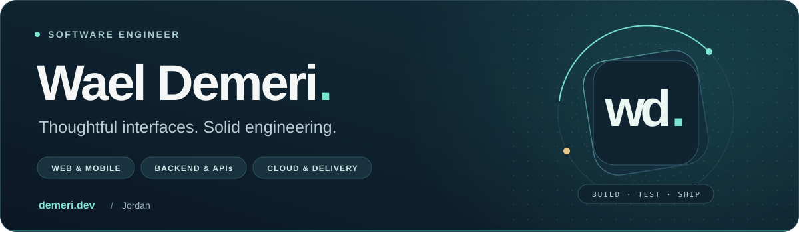
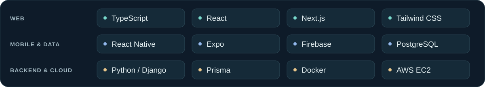

  

  <b><a href="https://demeri.dev">Portfolio ↗︎</a> &nbsp; · &nbsp; <a href="mailto:waeldemeri@gmail.com">Get in touch ↗︎</a> &nbsp; · &nbsp; <a href="https://certiblank.com">Try CertiBlank ↗︎</a> &nbsp; · &nbsp; <a href="https://wayline.demeri.dev">Try Wayline ↗︎</a></b>

  I build web and mobile applications, from the first screen to the API and deployment. 
  <b>Software Engineering graduate · Jordan · Open to opportunities</b>

 

## Selected work

<table>
<tr>
<td width="50%" valign="top">

### 01 &nbsp; CertiBlank

**A clearer path to your next certification.**

  

Timed mock exams, focused quizzes, answer explanations, and saved progress. Server-side grading, guest-to-account history, and Docker deployment on AWS EC2.

<code>Next.js</code> <code>TypeScript</code> <code>PostgreSQL</code> <code>AWS</code>

**[Live app ↗︎](https://certiblank.com)** &nbsp; · &nbsp; [Source & architecture](https://github.com/Demeriwael/certiBlank#architecture)

</td>
<td width="50%" valign="top">

### 02 &nbsp; Wayline

**A clear route. Every required stop.**

  

Truck trip planning with an interactive map, scheduled stops, and downloadable driver log sheets. A Python scheduling engine behind a Django REST API.

<code>React</code> <code>TypeScript</code> <code>Python</code> <code>Django</code>

**[Live demo ↗︎](https://wayline.demeri.dev)** &nbsp; · &nbsp; [Source & setup](https://github.com/Demeriwael/truckmena)

</td>
</tr>
<tr>
<td colspan="2" valign="top">

### 03 &nbsp; Tanzeem

**Less waiting. Better flow.** A mobile queue management system with real-time tracking, QR check-in, and dedicated visitor and administrator interfaces. My graduation project at Middle East University.

<code>React Native</code> <code>Expo</code> <code>TypeScript</code> <code>Firebase</code>

**[Explore the project ↗︎](https://github.com/Demeriwael/tanzeem)**

</td>
</tr>
</table>

## From interface to infrastructure

**Engineering habits:** accessible interfaces · server-side validation · automated tests · GitHub Actions · documented architecture and deployment.

## A little context

- **Software Engineering graduate** — Middle East University, Jordan.
- **Backend internship at Optimum Partners** — C#, ASP.NET, REST APIs, and SQL for a car rental application.
- **Freelance development** — client websites from design through deployment, including the bilingual [Kleon Law](https://kleonlaw.com) website.

 

<a href="https://demeri.dev">More work at demeri.dev</a>

